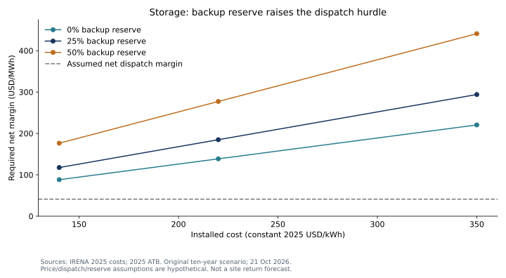

# Battery storage: what must flexibility earn?

**21 October 2026 · Public benchmark evidence plus an illustrative project model · Site underwriting: NEEDS_DATA.**

**Conclusion:** cheaper battery hardware does not by itself make storage an economic solution to an AI site's power constraint. At the public four-hour cost benchmark, the model needs a net dispatch margin of **$117.62/MWh** with 25% of energy reserved for backup. The assumed buying/selling prices yield only **$41.18/MWh** after charging losses. A separate availability or resilience benefit would need to cover **$6.88m a year** over ten years. That is a diligence hurdle, not an estimated revenue stream.

## Evidence and independent contribution

[IRENA's 2025 cost study](https://www.irena.org/-/media/Files/IRENA/Agency/Publication/2026/Jul/IRENA_TEC_RPGC_2025_Executive_summary_2026.pdf), published July 2026, gives an approximately **$140/kWh** installed-cost benchmark for four-hour batteries. It replaces an older global benchmark as current context; it is not a US data-centre bid. The [2025 Annual Technology Baseline](https://atb.nlr.gov/electricity/2025/utility-scale_battery_storage) supplies published modeling assumptions of 85% round-trip efficiency, 15-year life and annual fixed operating costs of 4% of initial capex. That operating-cost assumption includes augmentation to maintain capacity, so the model does not add a second degradation/replacement charge.

The original analysis turns these inputs into a cost/reserve hurdle matrix. The accompanying sell-side reading guided the question; no proprietary project estimates, chart or company universe is reproduced. [Source register](sources.json) distinguishes reported benchmarks from published modeling assumptions.

## Model and counterfactual

The counterfactual is no battery: all modeled costs and benefits are incremental. An illustrative 100 MW / 400 MWh system cycles 300 times a year. The model reserves 25% of energy, buys at $50/MWh, sells at $100/MWh and discounts end-year real, pre-tax unlevered cash flows at 8%. These are assumptions, not observed tariffs or an optimized dispatch schedule. Capital is paid at time zero; terminal recovery is zero.

Annual dispatch = MWh × cycles × (1 − reserve). Net margin = selling price − charging price / efficiency. NPV = discounted dispatch margin − initial capex − discounted fixed costs. The hurdle divides discounted costs by discounted dispatched MWh. All money is **constant 2025 USD**; charging and discharge prices use that same convention.

At $220/kWh and the same reserve, the required margin rises to **$184.83/MWh**. At 50% reserve and $140/kWh it is **$176.43/MWh**. A separate 15-year case reduces the reference hurdle to **$97.58/MWh**; extending life is not a free improvement to the existing ten-year comparison. [All results](RESULTS.md) · [Inputs](inputs.json) · [Model](model.py).

## Contrary case and next decision

A contracted capacity payment, high-value outage avoidance, lower site costs or a different dispatch profile could make storage attractive. Conversely, interconnection work, fees, curtailed charging, cycling limits and unavailable tax benefits can worsen the economics. A battery shifts energy; it cannot supply sustained new capacity without a charging source. The fixed-price model does not establish feasible hourly arbitrage.

**NEEDS_DATA:** dated local EPC/interconnection bids; hourly charging and load constraints; reserve and reliability requirements; warranties; operating terms; and separately evidenced, non-overlapping availability or outage benefits. Next compare a real quote and contracted net annual benefit with the $6.88m reference hurdle, then rerun a site-specific hourly model. Backup benefits receive no invented revenue here and cannot also be counted as unconstrained dispatch revenue.

This is a companion to the [AI infrastructure grid/gas case](../ai-infrastructure/README.md). Its pre-tax real NPV must not be added to that after-tax model without reconciling taxes, price basis, timing and asset ownership. No issuer valuation, research approval or independent human validation is claimed.

## Reproduce

From the repository root: `python examples/battery-storage/model.py --check`. Python 3.10+, standard library, no network. Use `--write` only to intentionally regenerate outputs. The optional chart command is documented in [chart reproduction](../PUBLIC_CASES.md).
