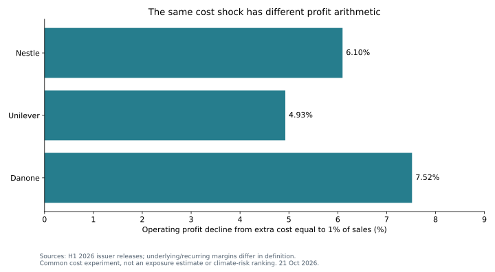

# Climate and staples: transmission matters more than a weather label

**21 October 2026 · Three real issuers; common hypothetical procurement scenarios · Issuer earnings forecast: NEEDS_DATA.**

**Conclusion:** a weather narrative is not enough to rank staples earnings risk. Procurement exposure, timing, hedging, pricing and demand response determine the transmission. There is also an accounting trap: Danone moved **€1,809m** of H1 logistics and industrial expenses into cost of goods sold. Applying a common commodity percentage to differently defined COGS creates a spurious difference in modeled exposure.

## Public evidence and original analysis

The baseline uses H1 2026 disclosures from [Nestlé](https://www.nestle.com/media/pressreleases/allpressreleases/half-year-results-2026), [Unilever](https://www.unilever.com/news/press-and-media/press-releases/2026/desire-at-scale-powering-strong-h1-performance/) and [Danone](https://www.danone.com/content/dam/corp/global/danonecom/investors/en-all-publications/2026/interim-financial-report/2026interimfinancialreport.pdf). Their underlying/recurring profit margins are 16.4%, 20.3% and 13.3%, with different non-GAAP definitions. Danone's Note 1.4 explains the presentation change; the source register preserves its locator and amount.

The original model isolates the earnings mechanics and challenges comparability. An unmitigated incremental cost equal to 1% of sales would reduce baseline operating profit by **6.10%, 4.93% and 7.52%**, respectively. This is a common cost experiment, **not an estimate of each company's exposure or a climate-risk ranking**. No stock-price inference follows from it.

[NOAA's October ENSO discussion](https://www.cpc.ncep.noaa.gov/products/analysis_monitoring/enso_disc_oct2026/ensodisc.shtml) is weather context only. The analysis does not infer a commodity-price shock from ENSO probabilities. Crop, region, season, supply response and inventories would first have to be connected using independent evidence. The research reading shaped these questions; its recommendations and proprietary sensitivities are not inputs.

## Scenario mechanism

The [monthly model](model.py) normalizes sales to 100 and applies disclosed H1 cost/margin structures to a hypothetical twelve-month profile. It does not annualize reported sales or forecast the next fiscal year. Assumptions: 10% of COGS is exposed; commodity price rises 20%; FX is unchanged; 50% of the shock is protected through calendar month six; inventory delays cost recognition three months; pricing passes through 60% with a further three-month lag; a 1% price increase reduces volume 0.5%.

The inventory lag and hedge clock are distinct: inventory defers recognition while hedge protection expires in calendar time. Pricing follows the recognized cost shock; other operating expenses remain fixed. Commodity/FX shocks compound. Unit COGS and sales scale with volume. These simplifying assumptions require calibration before issuer use.

The lagged scenario reduces profit **2.95% / 2.37% / 4.14%** for Nestlé / Unilever / Danone. Moving Danone's reclassified costs back to other expense, with unchanged baseline profit, changes its modeled decline to **3.38%**. This is a presentation control, not a reconstructed commodity purchasing ledger. [Results](RESULTS.md) · [Assumptions](inputs.json) · [Sources](sources.json).

## What could reverse the conclusion?

Successful hedging, immediate price recovery, favorable FX, lower other input costs or mix improvements can absorb commodity pressure. Volume loss, weak brands and emerging-market FX can amplify it. The company with the lowest starting margin need not have the highest exposure, weakest pricing or worst expected return.

**NEEDS_DATA:** commodity/country procurement weights, contract currency, hedge expiry and basis, inventory duration, category elasticity and pricing realization. Unilever's planned Foods separation also requires a perimeter recast before applying this baseline to a future separated business. Next reconcile those inputs to a company-reported cost/pricing bridge. Until then, no EPS or valuation bridge is defensible. This standalone case has no workflow research approval or independent human validation.

## Reproduce

From the root: `python examples/climate-staples/model.py --check`. Python 3.10+, standard library, offline. [Chart reproduction](../PUBLIC_CASES.md). A [climate-research handoff](https://github.com/HHFinAi/climate-investment-ai-agent-in-equity-and-bond-markets/tree/main/examples/climate-staples) explains the weather-to-procurement evidence still required.
