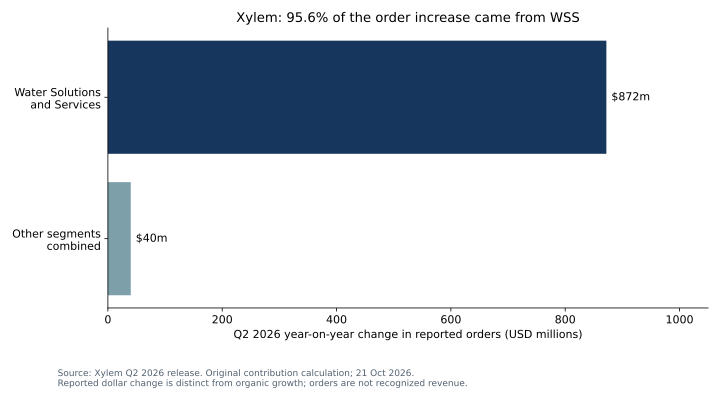

# Water and waste: separate demand, pricing and conversion

**21 October 2026 · Three-issuer public operating monitor · Valuation: NEEDS_DATA.**

**Conclusion:** the strongest observable signal is Xylem's order intake, but its concentration makes backlog conversion the next question. Veralto offers a distinct water-quality growth observation. WM's pricing and comparator-adjusted volume must be separated before interpreting infrastructure demand. These are three operating mechanisms, not interchangeable measures of adaptation revenue.

## What the releases actually establish

| Issuer / reviewed period | Observation | Investment interpretation and contrary case |
|---|---|---|
| Xylem, Q2 2026 | Revenue $2,336m; orders $3,086m; organic revenue +1% and orders +41%, rounded as disclosed. WSS contributes $872m of the $912m reported dollar order increase. | Book-to-bill is 1.32x and WSS accounts for 95.6% of the order increase. Delivery schedules and contract quality matter. Concentration or long-cycle projects could delay cash conversion; this does not establish broad municipal acceleration. |
| Veralto, Q2 2026 | Group core growth 4.2%; Water Quality core growth 5.7%; adjusted operating margin 24.6%. Q3 group core-growth guidance 4–5%. | Segment exposure provides a more direct operating observation than the group label. Guidance is a management expectation. Product mix, acquisition effects and tariff-refund benefits complicate a normalized earnings inference. |
| WM, Q2 2026 | Core price 5.7%; realized yield 3.6%; collection/disposal volume −1.8%, or −0.4% excluding the prior wildfire comparator. | The 1.4 percentage-point comparison effect is not new demand. Pricing resilience can support profit while underlying volumes remain weak. Core price and yield overlap and must not be added. |

Primary releases: [Xylem SEC exhibit](https://www.sec.gov/Archives/edgar/data/1524472/000152447226000108/xyl07282026ex991.htm), [Veralto](https://investors.veralto.com/2026-07-28-Veralto-Reports-Second-Quarter-2026-Results), [WM](https://investors.wm.com/news-releases/news-release-details/wm-announces-second-quarter-2026-earnings/). The [source register](sources.json) preserves dates, units, locators and definitions. The [EPA revolving-fund framework](https://www.epa.gov/water-infrastructure/water-infrastructure-state-revolving-funds) explains a funding channel; it is not a verified order, appropriation drawdown or issuer revenue forecast.

## Original calculations and boundaries

The [model](model.py) calculates order/revenue, segment contribution to the dollar order change, a guidance midpoint and the volume-comparator difference. It does not infer growth from non-comparable margin rankings: Xylem reports adjusted EBITDA, Veralto adjusted operating profit and WM adjusted operating EBITDA. Nor does it sum reported revenue growth, core price and yield into a false reconciliation. WM's comparative accounting basis is retained as presented.

The research reading helped identify useful questions. This bounded three-issuer sample and its calculations come from public primary releases; it is not a reproduced bank universe or recommendation list. [Results](RESULTS.md) include all computed observations.

## What would change the view?

For Xylem: timely conversion accompanied by cash generation strengthens the demand interpretation; cancellations, working-capital expansion or slippage weaken it. For Veralto: sustained Water Quality core growth with normalized margin and cash conversion strengthens the quality argument. For WM: improved collection/disposal volume excluding unusual comparators would provide stronger demand evidence than price alone.

**NEEDS_DATA:** backlog maturity and cancellation rights, order-to-cash conversion, recurring/service mix, comparable return on invested capital, normalized adjustments, executable prices and valuation expectations. These gaps prevent a security ranking. The [prospective evaluation](../../evaluation/prospective-research/README.md) freezes three narrow operating hypotheses before Q3 releases and records no observed outcomes yet. Scoring them will test those hypotheses, not investment alpha or causal climate attribution.

## Reproduce and monitor

From the root: `python examples/water-waste/model.py --check`. Python 3.10+, standard library, offline. [Chart reproduction](../PUBLIC_CASES.md). Refresh sources only in a dated new observation record; preserve this cutoff and the frozen forecast register. No scheduler, engagement, research approval or independent human validation is implied.
